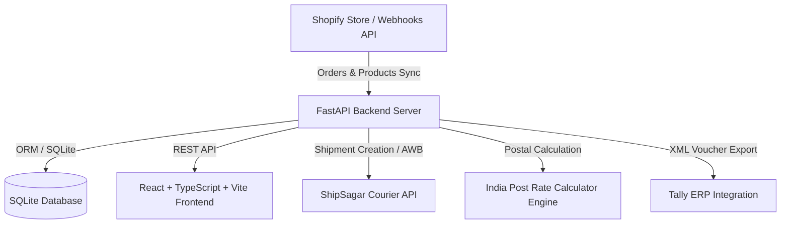

# Comprehensive Project Overview: Shopify Connection & Logistics Platform

## 1. Executive Summary

**Shopify Connection** is an enterprise-grade e-commerce order management, courier logistics, financial ledger, and ERP sync platform. It bridges Shopify online stores with shipping logistics providers (such as **ShipSagar** and **India Post**), offers real-time order tracking, provides automated India Post freight estimation based on parcel dimensions, and synchronizes accounting data directly with **Tally ERP**.

---

## 2. Architecture & Tech Stack



### **Frontend Architecture**
- **Framework**: React 18 + TypeScript + Vite
- **Styling**: Tailwind CSS + Custom CSS modules + Glassmorphism / UI dynamic design
- **State & API**: Custom React hooks + Fetch API wrapper with auto toast notifications
- **Icons & Visuals**: Lucide React + Shopify Product CDN Image Avatars

### **Backend Architecture**
- **Framework**: Python FastAPI (Async ASGI framework)
- **Database**: SQLAlchemy 2.0 ORM + SQLite database engine (`app.db`)
- **Data Validation**: Pydantic v2 Schemas
- **Testing**: Pytest (Backend: 370+ tests), Vitest + React Testing Library (Frontend: 133 tests)

---

## 3. Core Modules & Functionality

### 🛍️ **1. Order Management & Shopify Catalog Sync**
- **Order Synchronization**: Syncs orders automatically via Shopify REST API and real-time webhook topics (`orders/create`, `orders/updated`, `orders/fulfilled`, `orders/cancelled`).
- **Product Catalog & Image Syncing**:
  - Automatically indexes store products and variants (`products/create`, `products/update` webhooks).
  - Background startup backfill engine (`backfill_missing_product_images()`) fetches exact CDN images directly from Shopify REST API.
  - Interactive **Shopify Product Catalog Selector** built into the **New Order** dialog (`NewOrderDialog.tsx`), showing title, SKU, price, and thumbnail.
- **Order Details Modal (`OrderDetailDialog.tsx`)**:
  - Displays customer info, delivery address, tracking details, and exact line item photos.
  - Body scroll lock (`document.body.style.overflow = "hidden"`) prevents background scrolling while viewing details.
- **Editable Order Parameters (`EditOrderDialog.tsx`)**:
  - Allows editing order items, recipient details, and exact parcel dimensions (**Weight in grams, Length, Breadth, Height in cm**).

### 📮 **2. Shipping & Freight Estimation (India Post & ShipSagar)**
- **India Post Rate Engine (`frontend/src/lib/india-post.ts`)**:
  - Calculates **Actual Weight** vs **Volumetric Weight** ($L \times B \times H / 5000$).
  - Calculates **Billable Weight**, **Base Postage**, **COD Fee**, **GST (18%)**, and **Total Shipping Cost**.
- **ShipSagar Carrier Integration (`app/api/shipsagar.py`)**:
  - Automated AWB creation, shipping labels generation, pickup scheduling, and live tracking status sync.

### 💰 **3. Financial Ledger & Tally ERP Sync**
- **Double-Entry Financial Ledger (`app/api/ledger.py`)**:
  - Tracks freight charges, COD remittances, carrier claims, and net balances.
- **Tally ERP Sync (`app/api/tally.py`, `TallySettings.tsx`)**:
  - Exports sales vouchers, receipt vouchers, and ledger masters directly into Tally XML format.

### 📊 **4. Analytics & SLA Monitoring**
- **Dashboard (`Dashboard.tsx`)**: Real-time stats on orders, shipments, delivery status distribution, and revenue trends.
- **SLA Tracking (`app/api/sla.py`)**: Monitors shipment delivery timelines, flags delayed orders, and generates exception alerts.

---

## 4. Database Schema Highlights

```mermaid
erdiagram
    Order ||--|{ OrderItem : contains
    Product ||--|{ ProductVariant : has
    Order ||--o| Parcel : shipped_via
    Order ||--o| Shipment : tracked_by
    Order ||--o| LedgerEntry : records

    Order {
        string id PK
        string name
        string shopify_order_id
        string customer_name
        string customer_phone
        float total_price
        float weight_grams
        float length_cm
        float breadth_cm
        float height_cm
    }

    OrderItem {
        string id PK
        string order_id FK
        string product_id
        string variant_id
        string title
        string sku
        float price
        int quantity
        string image_url
    }

    Product {
        string id PK
        string title
        string vendor
        string image_url
    }
```

---

## 5. Primary API Routes Overview

| Group | Endpoint | Method | Description |
| :--- | :--- | :--- | :--- |
| **Orders** | `/api/v1/orders` | `GET` | List orders with search, filters & pagination |
| **Orders** | `/api/v1/orders` | `POST` | Create a new manual order |
| **Orders** | `/api/v1/orders/{id}` | `PUT` | Edit order details, items, & parcel dimensions |
| **Products** | `/api/v1/products` | `GET` | Fetch Shopify synchronized product catalog |
| **Shopify** | `/api/v1/shopify/sync` | `POST` | Trigger manual full store sync with Shopify |
| **Webhooks** | `/api/v1/webhooks/shopify` | `POST` | Receive real-time Shopify webhooks |
| **Carrier** | `/api/v1/shipsagar/shipments` | `POST` | Create courier shipment & get AWB number |
| **Tally** | `/api/v1/tally/export` | `GET` | Generate XML payloads for Tally ERP |

---

## 6. Project Verification & Quality Assurance

- **Frontend Test Suite**: 133 tests passing (`Vitest`).
- **Backend Test Suite**: 370+ tests passing (`Pytest`).
- **Image Fallback Strategy**: Triple-layer lookup (Exact Variant/Product `image_url` -> Keyword Matcher -> Curated Fallbacks).
